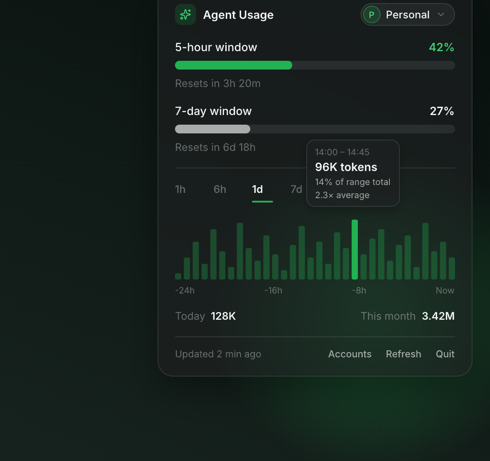
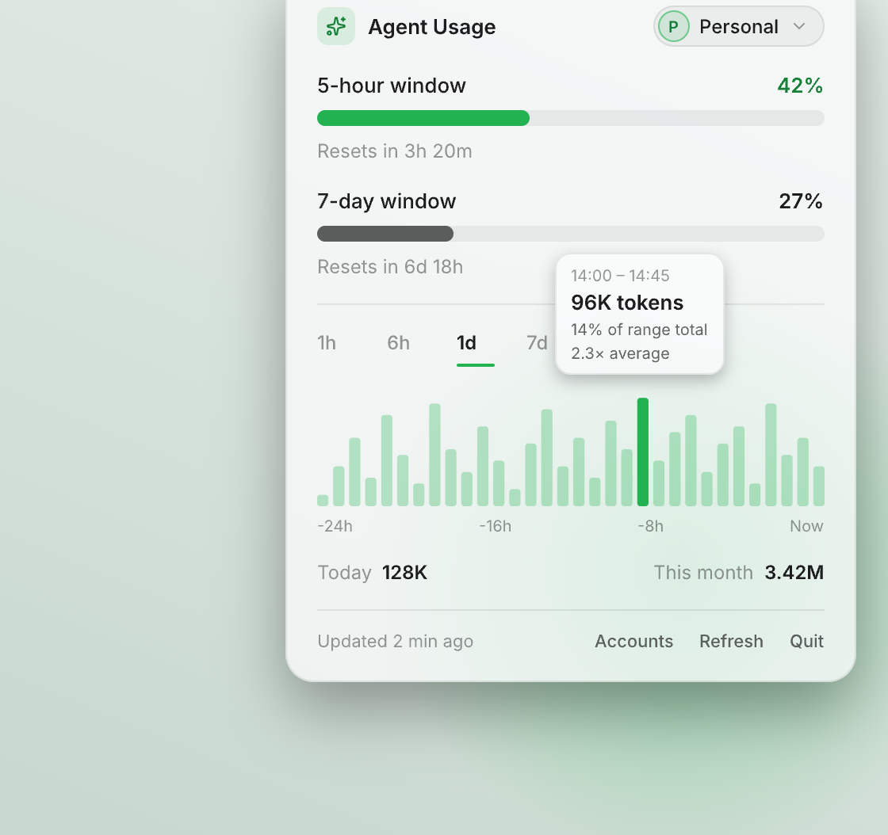
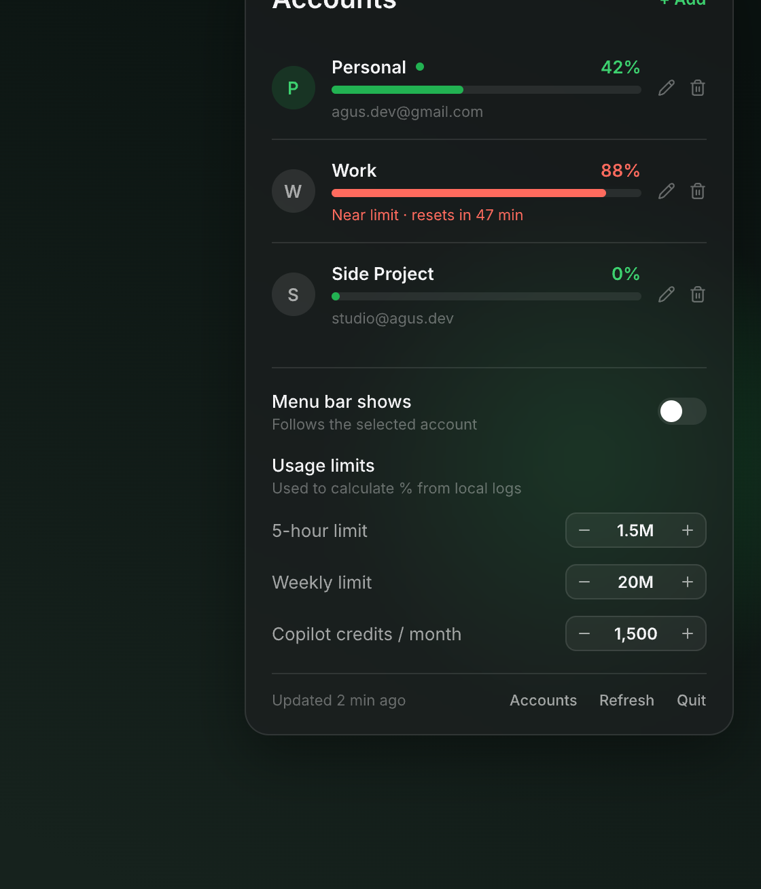
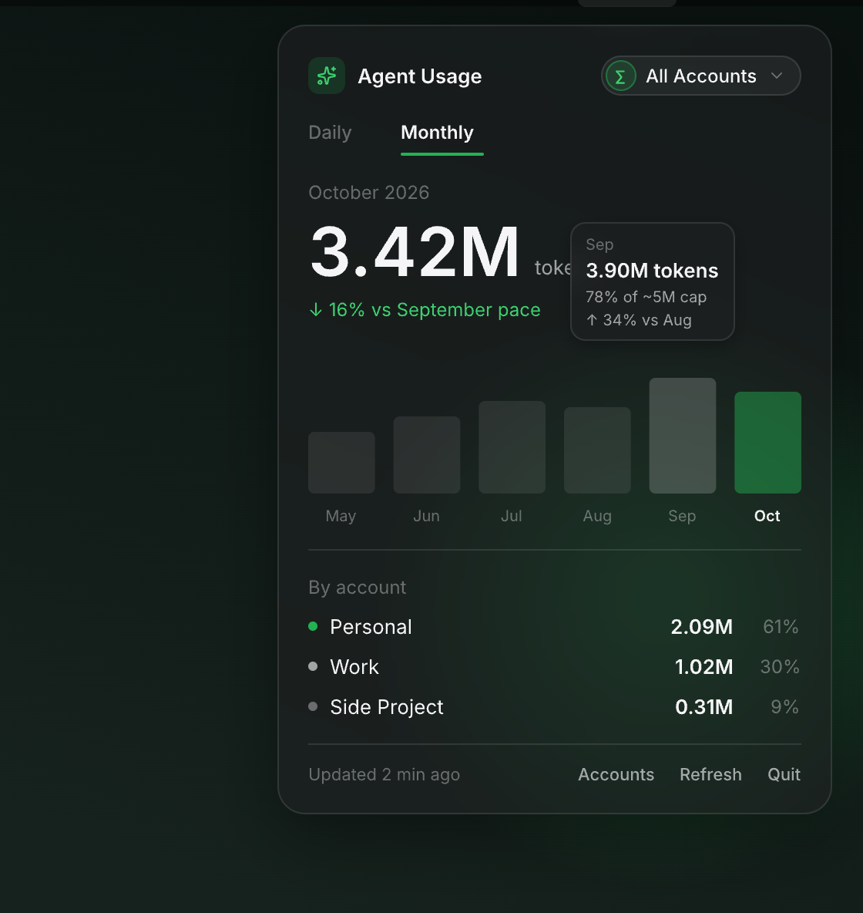
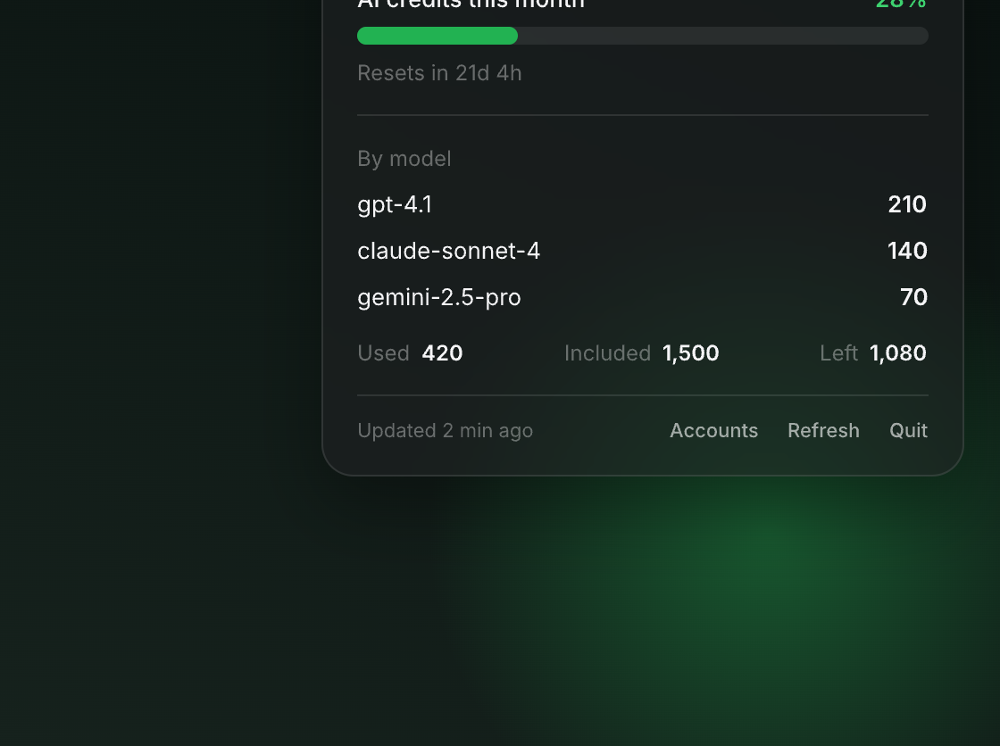
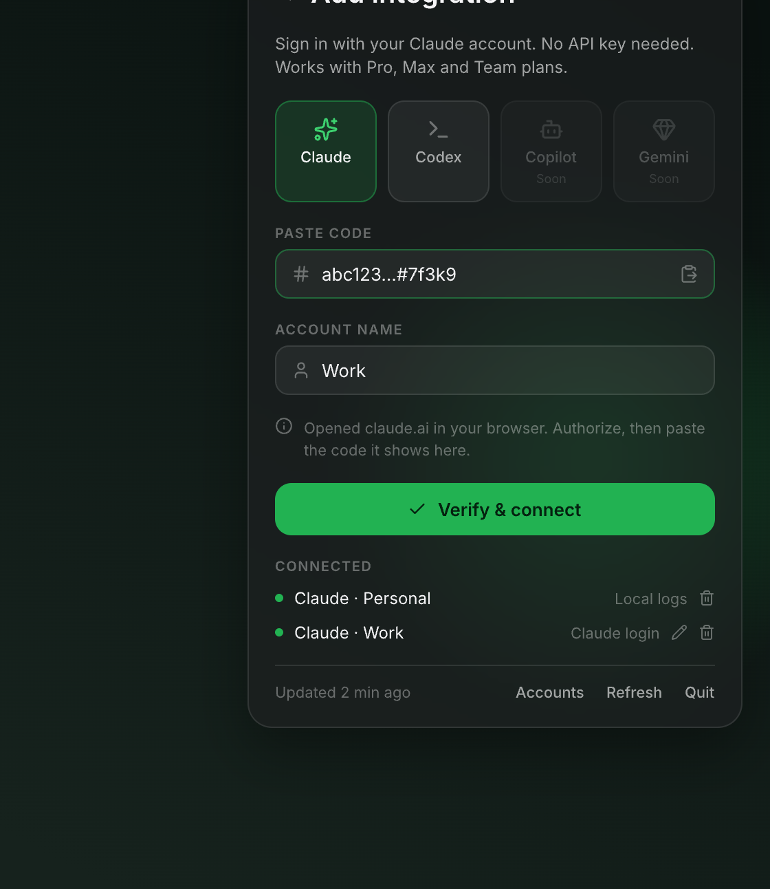
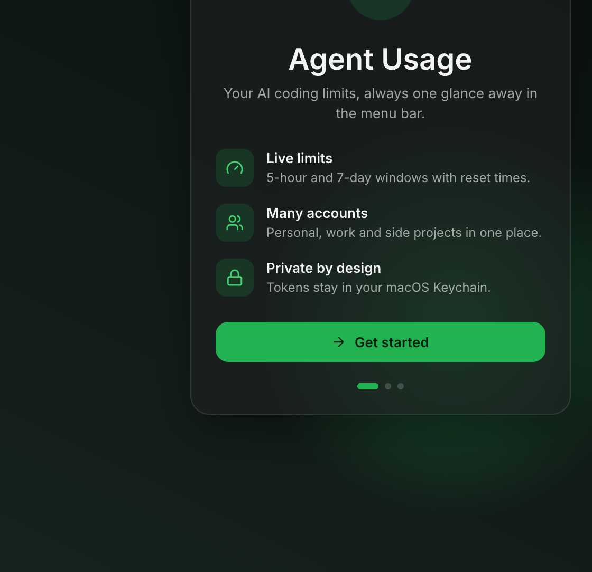
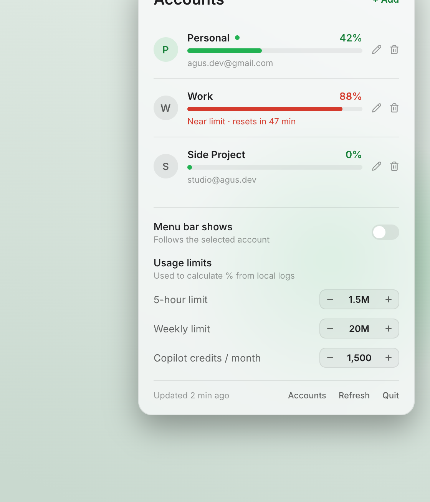

<h1 align="center">Agent Usage</h1>

<p align="center">
  Your AI coding limits, always one glance away in the macOS menu bar.
</p>

<p align="center">
  
  
  
  
</p>

<p align="center">
  
  &nbsp;
  
</p>

> The images in this README are design previews exported from the project's design file. Numbers shown are sample data.

## Overview

**Agent Usage** is a small menu bar app that shows how much of your AI coding quota you have used, so you stop guessing when you will hit a rate limit. It supports several providers and several accounts, and works in light and dark mode.

The menu bar icon shows the app mark with two mini bars: `5h` (current session) and `7d` (weekly). Click it for the full picture.

## Features

- **Live limits** for the 5-hour session and 7-day window, with reset countdowns.
- **Multiple accounts** (personal, work, side projects). The icon follows the selected account, or the highest-usage one if you prefer.
- **Usage chart** over 1h, 6h, 1d, 7d and 30d, with a hover tooltip showing time range, tokens, share of total and multiple of the average.
- **Monthly view** with a 6-month chart, projection against last month and a per-account breakdown.
- **Several providers**: Claude, Codex and GitHub Copilot (Gemini is planned).
- **Private by design**: credentials live in the macOS Keychain, and the app talks only to the providers you connect.
- **Native look**: SwiftUI, system vibrancy, automatic light and dark mode.
- **First-launch walkthrough** that helps you connect your first source.

## Screenshots

<table>
  <tr>
    <td align="center"><br><sub>Accounts and limits</sub></td>
    <td align="center"><br><sub>Monthly view</sub></td>
    <td align="center"><br><sub>GitHub Copilot credits</sub></td>
  </tr>
  <tr>
    <td align="center"><br><sub>Add an integration</sub></td>
    <td align="center"><br><sub>Welcome</sub></td>
    <td align="center"><br><sub>Light mode</sub></td>
  </tr>
</table>

## Supported providers

| Provider | How it connects | What you get |
| --- | --- | --- |
| **Claude** (local logs) | Reads Claude Code logs in `~/.claude*/projects` (read-only). No sign-in. | Token usage, charts, history. Percentages use the limits you set. |
| **Claude** (login) | **Sign in with Claude** (OAuth with PKCE). | Real 5-hour and 7-day utilization and reset times from your subscription. |
| **Codex / OpenAI** | OpenAI **Admin key**, stored in the Keychain. | Token usage from the organization usage API. |
| **GitHub Copilot** | Fine-grained personal access token with **Account → Plan: Read**. | Monthly AI credits used, by model, and time until reset. Personal plans only. |
| **Gemini** | Planned. | |

### Connecting an account

1. Open the app and follow the walkthrough, or choose **Accounts → + Add** later.
2. Pick a provider.
   - **Claude**: press **Sign in with Claude**, authorize in the browser, paste the code shown, then **Verify & connect**.
   - **Codex**: paste an OpenAI Admin key.
   - **Copilot**: create a fine-grained token at GitHub → Settings → Developer settings and paste it.
3. Pick the account in the header switcher. Use **All Accounts** for the combined monthly view.

You can rename, re-authenticate or remove an integration from **Accounts**. Local-log sources can be hidden and restored.

## Limits

Providers that report real utilization (Claude login) need no setup. For local logs the app computes percentages from limits you can change under **Accounts → Usage limits**:

| Setting | Default |
| --- | --- |
| 5-hour limit | 1.5M tokens |
| Weekly limit | 20M tokens |
| Copilot credits / month | 1,500 (Copilot Pro) |

## Requirements

- macOS 13 (Ventura) or later
- Xcode 15+ / Swift 5.9+
- [XcodeGen](https://github.com/yonaskolb/XcodeGen) (only for the Xcode project): `brew install xcodegen`

## Build and run

```sh
git clone git@github.com:balitax/agentusage.git
cd agentusage

make setup      # install XcodeGen if missing
make run        # generate the project, build and launch
```

Prefer Xcode?

```sh
make open       # generates AgentUsage.xcodeproj and opens it
```

No Xcode project is needed for a quick run with SwiftPM:

```sh
make swift-run
```

The app runs as a menu bar item only (no Dock icon). It is unsandboxed because it reads Claude Code logs from your home directory.

## Make targets

Run `make help` for the full list.

| Target | Description |
| --- | --- |
| `generate` / `open` | Generate the Xcode project from `agentusage.yml`, optionally open it |
| `build` / `release` | Build Debug or Release with `xcodebuild` |
| `run` / `run-release` | Build and launch the app |
| `swift-build` / `swift-run` | Build or run with SwiftPM |
| `format` / `lint` | Format sources or check formatting with `swift-format` |
| `install` / `uninstall` | Copy the Release app to `/Applications` or remove it |
| `zip` / `dmg` | Package a Release build into `dist/` |
| `reset-onboarding` | Show the first-launch walkthrough again |
| `reset` | Clear saved preferences |
| `clean` / `distclean` | Remove build output, or also the generated project |

## Project structure

```
Sources/AgentUsage/
├── App/           App entry point and root view
├── Models/        Account, Integration, ProviderKind, UsageEvent, UsageRange, ...
├── Services/      Keychain, local log reader, provider clients
│   └── Providers/ ClaudeOAuth, OpenAIProvider, CopilotProvider, BucketClient
├── Stores/        UsageStore (state, refresh, integrations)
├── Theme/         Design tokens (light/dark), vibrancy surface
├── Utilities/     Formatters
└── Views/         Overview, Accounts, Monthly, Integrations, Onboarding, MenuBar, Components
agentusage.yml     XcodeGen project spec
Makefile           Developer tasks
```

## Privacy and security

- Tokens and OAuth credentials are stored only in the **macOS Keychain**. They are never written to disk in plain text or logged.
- Claude Code logs are read locally and read-only. Only token counts and timestamps are used. Prompts and responses are ignored.
- Network requests go only to the providers you connect (`claude.ai` and `api.anthropic.com`, `api.openai.com`, `api.github.com`).
- No analytics or telemetry.

## Notes and limitations

- **Claude login** uses an OAuth client and a usage endpoint that are not publicly documented. They can change or stop working at any time, and their use may be subject to Anthropic's terms.
- **Codex** and **Copilot** support is built from public API documentation and has not yet been verified against live accounts. If something looks off, please open an issue with the (redacted) response.
- Copilot billing endpoints only work for plans billed to a personal GitHub account. Organization-managed licenses are not supported yet.
- The `5h` / `7d` windows are Claude concepts. Copilot reports a monthly credit allowance instead.

## Roadmap

- [ ] Gemini support
- [ ] Notifications when you approach a limit
- [ ] Launch at login
- [ ] Organization-level Copilot usage
- [ ] Signed and notarized releases

## Contributing

Issues and pull requests are welcome. Please run `make format` before committing.

## Disclaimer

Agent Usage is an independent project. It is not affiliated with or endorsed by Anthropic, OpenAI, GitHub or Google. All product names and trademarks belong to their respective owners.

## License

[MIT](LICENSE) © 2026 Agus Cahyono
